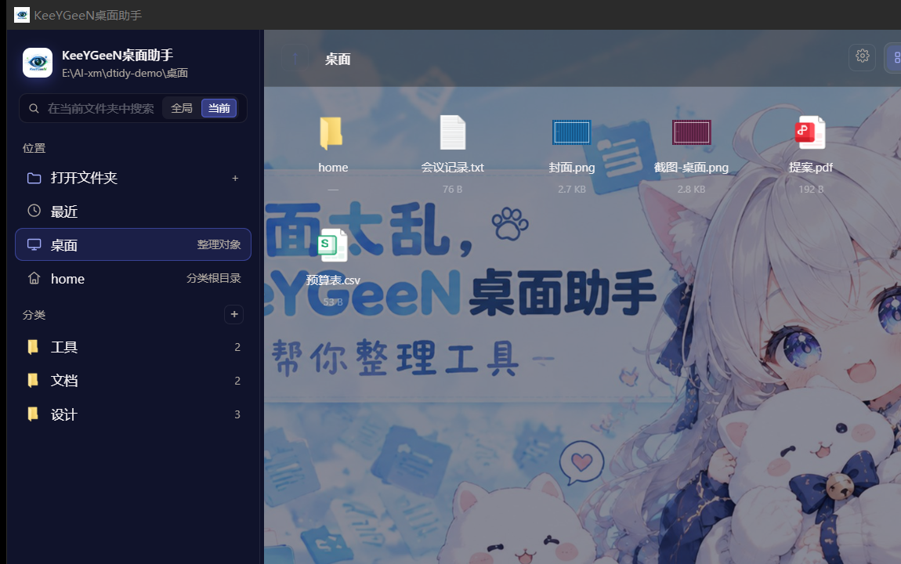
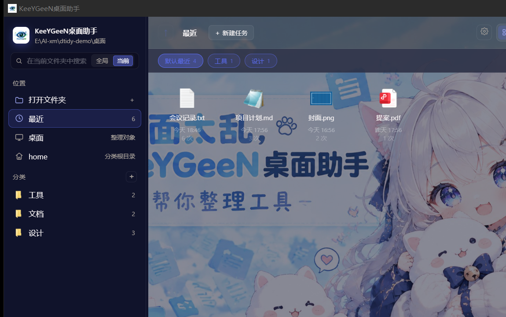
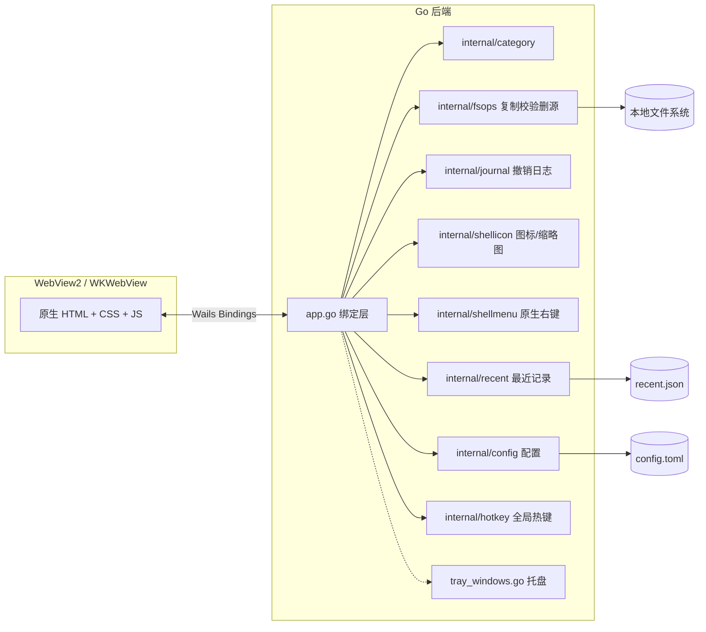

# KeeYGeeN桌面助手

> **桌面太乱，这里有招。**


一个用 Go + Wails 写的 Windows / macOS 桌面整理工具：把散落在桌面上的文件归类进 `home` 下的分类，支持搜索、最近打开记录、任务分组、托盘小图标、深浅配色与字体自定义。所有数据只保存在本机。

## 功能项

### 1. 一键归类，永不误删
- 分类统一放在 `<桌面>\home\<分类>`，整理根固定为 `home`
- 移动链路：**复制 → 校验（SHA-256）→ 重命名 → 删源**，任何一步失败都不会丢文件
- 冲突自动改名，永不覆盖；文件夹一律不移动
- 支持「撤销上一步」，按批次回滚

### 2. 最近打开 + 任务分组
- 侧栏「最近」自动记录**本程序内打开**与**系统里打开**的文件（轮询系统最近使用目录，解析 `.lnk` 目标）
- 同一路径合并计数，显示「最近打开时间 / 次数」
- 顶部「默认最近 / 任务…」胶囊标签，记录可拖到不同任务分组；**删除记录不删除原文件**
- 任务分组只是记录分组，不创建任何文件夹

### 3. 真实系统图标 + 图片缩略图
- 调用 Windows Shell 取 48×48 超大图标，图片文件优先显示 160px 缩略图
- 取图标失败自动回退到内置矢量图标

### 4. 系统托盘小图标
- 任务栏通知区域显示 KeeYGeeN 小图标，左键切换主窗口，右键菜单「显示主窗口 / 退出程序」
- 「关闭时隐藏到托盘」可持久化；资源管理器重启后自动恢复图标

### 5. Everything 风格搜索
- 侧栏顶部搜索框，260ms 防抖，多关键词全部命中
- Tab 唤出候选，↑↓ / − + 切换，Enter 打开；支持全局 / 当前文件夹范围

### 6. 完全自定义外观
- 整体颜色 / 页面颜色 / 返回按钮颜色 / 任务标签颜色，均可「跟随整体颜色」或单独取色
- 字体：字体族、字号、文字颜色可全局设置，也可按 **侧栏 / 路径栏 / 文件区 / 设置弹窗** 分区覆盖
- 背景图片：透明度、四种适配方式（完整 / 铺满 / 拉伸 / 平铺）、作用域（全局 / 文件区 / 拉选区域）

### 7. Windows 原生右键菜单
- 文件区右键调用系统原生菜单，与资源管理器一致（随安装的软件动态变化）
- 菜单运行在独立 STA 线程，带前台校验与超时保护，不会卡住界面

---

## 界面截图

| 图标视图 | 最近 + 任务分组 |
| --- | --- |
|  |  |

---

## 快速开始

1. 到 [Releases](../../releases) 下载：
   - Windows：`KeeYGeeN桌面助手-Setup.exe`
   - macOS：`KeeYGeeN-macOS-universal.zip`（解压后拖入「应用程序」）
2. 首次启动会自动在桌面创建 `home` 目录；
3. 把桌面文件拖到左侧分类，或在分类间拖动整理；
4. 设置里可改配色、字体、背景、热键、关闭行为。

> macOS 版本目前未签名，首次打开需在「系统设置 → 隐私与安全性」中允许。

---

## 从源码构建

依赖：Go 1.26+、[Wails v2.17](https://wails.io)、Node 仅用于前端可选（本项目前端为原生 HTML/CSS/JS，无需构建）。

```bash
# 安装 Wails CLI
go install github.com/wailsapp/wails/v2/cmd/wails@v2.17.0

# Windows
wails build -platform windows/amd64 -webview2 download

# macOS
wails build -platform darwin/universal
```

产物位于 `build/bin/`。Windows 安装包使用 Inno Setup 编译 `installer/KeeYGeeN桌面助手.iss`。

### 自动构建

`.github/workflows/build.yml` 已配置：

- push / PR：构建 Windows x64 与 macOS Universal 并上传 Artifact
- push `v*` 标签：自动创建 GitHub Release 并附带安装包

---

## 项目架构



核心设计：

- **安全移动**：`fsops.Move` 负责复制、校验、重命名、删源；`allowedDest/allowedSource` 限定可操作范围
- **可撤销**：`journal` 记录批次与反向操作，按批次回滚
- **平台隔离**：Windows 专用能力（托盘、Shell 菜单、热键、图标）都带 `_windows` 构建标签，非 Windows 平台使用桩实现
- **配置持久化**：`%APPDATA%\dtidy\config.toml`（macOS 为 `~/Library/Application Support/dtidy/config.toml`），最近记录在同目录 `recent.json`
- **无前端构建链**：`//go:embed all:frontend/dist` 直接打包静态资源

---

## 目录结构

```
.
├── app.go                 # Wails 绑定：状态、列表、搜索、移动、撤销、设置
├── app_recent.go          # 最近记录 / 任务分组接口
├── main.go                # 入口、单实例、托盘、关闭行为
├── tray_windows.go        # 系统托盘（Shell_NotifyIcon）
├── shellmenu/             # Windows 原生右键菜单（独立 STA 线程）
├── internal/
│   ├── category/          # 分类发现
│   ├── config/            # 配置读写与默认值
│   ├── fsops/             # 安全移动 / 扫描
│   ├── journal/           # 撤销日志
│   ├── recent/            # 最近记录存储与系统最近目录监听
│   ├── shellicon/         # 系统图标与图片缩略图
│   ├── hotkey/            # 全局热键
│   └── platform/          # 桌面路径 / 开机启动
├── frontend/dist/         # 原生前端（index.html / app.js / app.css）
├── installer/             # Inno Setup 安装脚本
├── build/                 # 图标与 Wails 资源
├── .github/workflows/     # Windows + macOS 自动构建与发布
├── docs/                  # PRD / DESIGN / 截图
└── assets/                # 宣传图与示例背景
```

---

## 数据与隐私

- 不联网、不上传任何文件；所有配置与记录都在本机配置目录
- 仓库与发布包中**不包含**任何个人数据、桌面文件或用户配置
- 最近记录只保存路径、次数与时间；删除记录不会删除磁盘文件

---

## 开源协议与二次开发

本项目使用 [MIT License](LICENSE)。

欢迎二次开发，但请遵守：

1. 保留 `LICENSE` 与原项目署名；
2. **基于本项目的衍生作品必须开源**，并在 README 中注明来源；
3. 不得使用 KeeYGeeN 名称与图标暗示官方背书。

---
